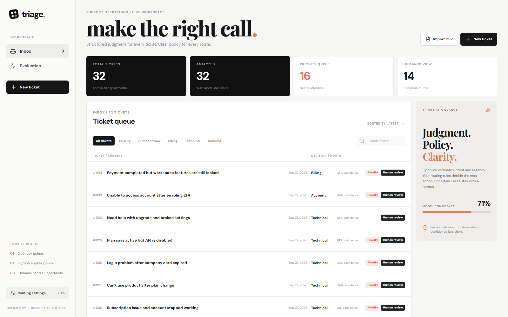
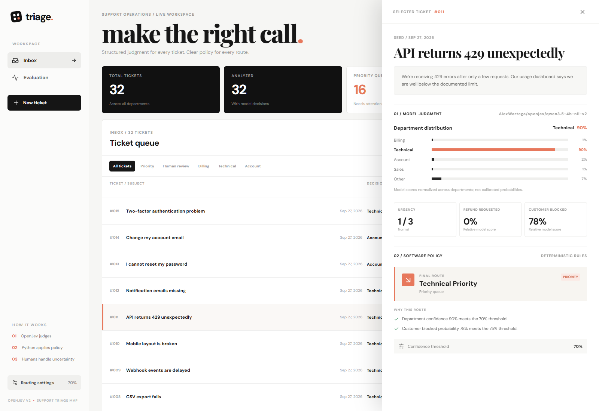
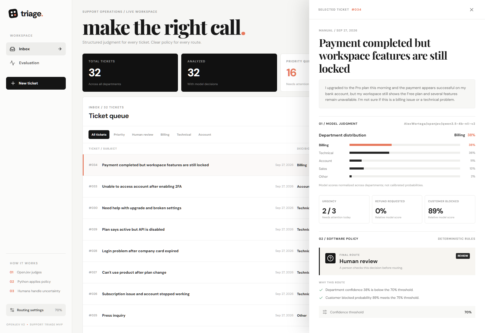
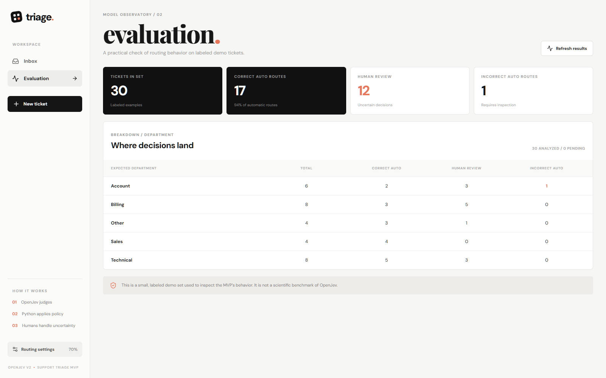
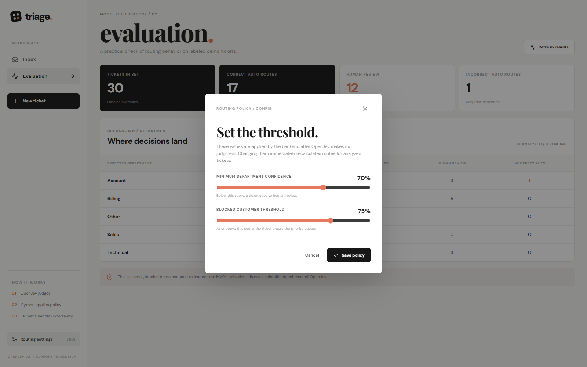
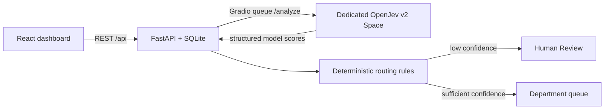

# Support Triage AI

**OpenJev judges. Python applies policy. Humans handle uncertainty.**

An interactive portfolio MVP for support ticket triage. OpenJev v2 returns four structured judgments; a FastAPI backend decides the route with explicit rules. Tickets with a weak department score go to Human Review. The React dashboard shows both stages separately.

## What is included

- Inbox with search and filters for priority, Human Review, Billing, Technical, and Account.
- Ticket creation and semicolon-delimited CSV import (UTF-8 or Windows-1252).
- Ticket detail with department distribution, urgency, refund request and blocked-customer scores, final route, and rule explanations.
- Adjustable department and blocked-customer thresholds, with routes recomputed from saved judgments.
- Evaluation page based on 30 labeled sample tickets. A checked-in snapshot contains **actual** OpenJev results, so the demo loads with data and does not call the GPU for every visitor.
- A dedicated private Hugging Face Space for inference. Its identifier is read by the backend from `OPENJEV_SPACE` and is never needed in the frontend.

## Product tour

### Inbox and routing overview

The inbox shows ticket status, department, priority, and Human Review at a glance. Search and filters narrow the queue.



### Model judgment and automatic routing

The ticket detail separates model scores from the deterministic policy decision. This example reaches the Technical priority queue, with both routing reasons shown.



### Human Review for uncertain cases

A low department score sends this mixed billing and technical request to a person. The high blocked-customer score remains visible alongside the review decision.



### Evaluation on labeled tickets

The evaluation page summarizes automatic routes, Human Review, and incorrect routes across the bundled demo set.



### Adjustable routing policy

The confidence and blocked-customer thresholds can be changed without rerunning the model; saved judgments are routed again with the new policy.



## Architecture



The model service answers only four questions: department, urgency (0–3), explicit refund request, and whether the customer is blocked. The backend normalizes the service response, applies a configurable confidence threshold (70% by default), then marks critical or likely blocked tickets as priority. Department confidence below the threshold goes to Human Review, even if the ticket is urgent; the priority flag stays visible.

The department values and binary scores are **relative entailment scores**, normalized within each set of candidate answers. They are useful for ranking and this demo's uncertainty policy, but are **not calibrated empirical probabilities**. The Evaluation page is a practical check on a small dataset, not a scientific benchmark.

## Run locally

Requirements: Python 3.12+, Node.js 20+, npm, and a Hugging Face token with read access to the private dedicated Space for **new analyses**. The checked-in demo snapshot can be browsed without a token.

```powershell
python -m venv .venv
.\.venv\Scripts\python.exe -m pip install -r backend\requirements.txt
Copy-Item .env.example .env
# In .env, set HF_TOKEN and OPENJEV_SPACE (owner/name of your private Space).
# Keep .env private; it is ignored by Git.
$env:PYTHONPATH='backend'
.\.venv\Scripts\python.exe -m uvicorn app.main:app --host 127.0.0.1 --port 8000
```

In another terminal:

```powershell
cd frontend
npm ci
npm run dev
```

Open `http://localhost:5173`. The backend API docs are at `http://127.0.0.1:8000/docs`. On first startup, the backend imports `sample_support_tickets.csv` into SQLite and applies the checked-in real-model snapshot. Repeated startup/import skips duplicate CSV tickets. Tickets created in the app can be analyzed by the dedicated Space; a model outage returns an explicit API error instead of a fabricated result.

## Tests and snapshot refresh

```powershell
$env:PYTHONPATH='backend'
.\.venv\Scripts\python.exe -m pip install -r backend\requirements-dev.txt
.\.venv\Scripts\python.exe -m pytest backend\tests -q
cd frontend
npm run build
```

To regenerate `backend/data/demo_analysis.json` from the model, set `HF_TOKEN` and `OPENJEV_SPACE` in `.env`, then run `python backend/scripts/analyze_seed.py` with `PYTHONPATH=backend`. The command is resumable; it keeps completed ticket results if the Space queue becomes temporarily unavailable.

## Deploy

- **Model:** the new Space is private and uses ZeroGPU. Its `/analyze` endpoint is called through `gradio_client`, which uses the Space queue. Cold starts, queue time, and GPU quotas can affect new analyses.
- **Backend:** deploy the root `Dockerfile` on a Python container host. Set `HF_TOKEN` and `OPENJEV_SPACE` as server-side secrets, and `CORS_ORIGINS` to the frontend origin. Set `TRIAGE_DB_PATH` to a mounted persistent volume if visitor-created tickets must survive container restarts. No token or Space identifier belongs in the frontend build.
- **Frontend:** deploy `frontend/` as a Vite static site (`npm ci && npm run build`, output `dist/`). Set `VITE_API_BASE_URL` to the deployed backend URL ending in `/api`. The local Vite proxy is only for development.

This MVP has no authentication: ticket creation/import and routing settings are shared within one backend instance. Treat a public deployment as a disposable demo using synthetic tickets, and reset its SQLite data as needed. The Evaluation page remains tied to the 30 bundled seed tickets.

Do not commit `.env`, SQLite databases, personal tokens, or the private Space identifier. See [the Space service README](space/README.md) for the model contract.

## Repository map

| Path | Purpose |
| --- | --- |
| `frontend/` | React + TypeScript dashboard |
| `backend/app/model.py` | OpenJev client and response normalization |
| `backend/app/routing.py` | Deterministic policy and Human Review |
| `backend/app/storage.py` | SQLite and CSV import |
| `backend/app/main.py` | REST API and evaluation |
| `space/` | Dedicated Hugging Face model service source |
| `docs/screenshots/` | Five screenshots for the product tour |
| `sample_support_tickets.csv` | 30 labeled demo cases |
